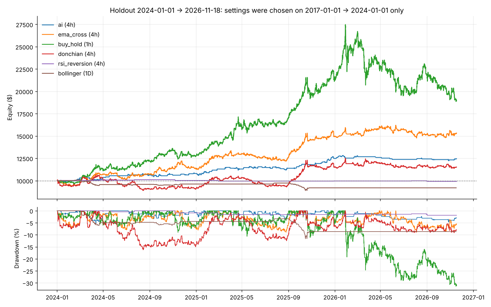

# XAUUSD automatic backtest report

Generated 2026-11-18 04:13 UTC in 26.2 min. Data: Dukascopy spot XAUUSD (BID), hourly candles resampled as needed.

* **Development period** (all settings chosen here): 2017-01-01 to 2024-01-01
* **Holdout period** (never used for any choice): 2024-01-01 to 2026-11-18
* Costs: spread $0.3/oz, commission $7.0/lot, slippage $0.05/oz; risk 1% of equity per trade; starting capital $10,000
* Configurations tested: 273 (216 AI, 57 rule-based)

## Verdict

The AI's chosen setup (`ai|4h|logreg|h12|sl2.0/tp3.0|p>0.4`) returned **+24.5%** on the holdout (Sharpe 1.40, max drawdown -5.1%, 141 trades), compared with Sharpe 0.52 in development. The best rule-based strategy, `ema_cross|4h|fast=10,slow=30|slNone/tpNone`, returned +53.3% (Sharpe 1.25). Simply buying and holding gold returned +89.2% (Sharpe 1.14, max drawdown -31.4%). The AI kept a positive risk-adjusted edge on unseen data. Paper-trade it before risking money.

## Winner of each strategy family on the holdout

Each row is the configuration with the best *development* Sharpe in its family.

| name                                           | timeframe   |   dev_sharpe |   dev_return_% |   hold_sharpe |   hold_return_% |   hold_cagr_% |   hold_maxdd_% |   hold_trades |   hold_win_% |   hold_pf |
|:-----------------------------------------------|:------------|-------------:|---------------:|--------------:|----------------:|--------------:|---------------:|--------------:|-------------:|----------:|
| ai|4h|logreg|h12|sl2.0/tp3.0|p>0.4             | 4h          |         0.52 |          21.22 |          1.4  |           24.49 |          7.91 |          -5.06 |           141 |        53.9  |      1.51 |
| ema_cross|4h|fast=10,slow=30|slNone/tpNone     | 4h          |         0.5  |          50.41 |          1.25 |           53.3  |         16.01 |          -8.98 |           141 |        31.91 |      1.73 |
| buy_hold|1h||slNone/tpNone                     | 1h          |         0.68 |          82.07 |          1.14 |           89.22 |         24.81 |         -31.38 |             1 |       100    |    inf    |
| donchian|4h|n=20|slNone/tpNone                 | 4h          |         0.53 |          52.25 |          0.47 |           15.29 |          5.07 |         -16.26 |            76 |        35.53 |      1.26 |
| rsi_reversion|4h|lower=30,upper=70|sl2.0/tp3.0 | 4h          |         0.13 |           0.91 |         -0.27 |           -0.82 |         -0.28 |          -1.89 |            15 |        60    |      0.73 |
| bollinger|1D|k=2.5|slNone/tpNone               | 1D          |         0.15 |           3.2  |         -0.85 |           -8.04 |         -2.87 |         -11.65 |             8 |        62.5  |      0.27 |

## Top 10 AI configurations (ranked on development) and how they held up

If the holdout numbers collapse compared with development, the edge was probably curve-fitted.

| name                                | timeframe   |   dev_sharpe |   dev_return_% |   hold_sharpe |   hold_return_% |   hold_cagr_% |   hold_maxdd_% |   hold_trades |   hold_win_% |   hold_pf |
|:------------------------------------|:------------|-------------:|---------------:|--------------:|----------------:|--------------:|---------------:|--------------:|-------------:|----------:|
| ai|4h|logreg|h12|sl2.0/tp3.0|p>0.4  | 4h          |         0.52 |          21.22 |          1.4  |           24.49 |          7.91 |          -5.06 |           141 |        53.9  |      1.51 |
| ai|4h|logreg|h12|sl2.0/tp3.0|p>0.55 | 4h          |         0.48 |           8.8  |          0.66 |            4.27 |          1.46 |          -3.14 |            21 |        52.38 |      1.6  |
| ai|1D|gbm|h5|sl2.0/tp3.0|p>0.5      | 1D          |         0.42 |           3.61 |          0.71 |            2.26 |          0.78 |          -1.51 |            10 |        60    |      2.06 |
| ai|4h|logreg|h6|sl1.0/tp2.0|p>0.383 | 4h          |         0.4  |          18.48 |          1.75 |           42.23 |         13.02 |          -6.58 |           125 |        53.6  |      1.81 |
| ai|4h|logreg|h12|sl2.0/tp3.0|p>0.5  | 4h          |         0.38 |           8.24 |          0.79 |            7.18 |          2.44 |          -4.73 |            43 |        53.49 |      1.51 |
| ai|4h|logreg|h6|sl1.0/tp2.0|p>0.433 | 4h          |         0.36 |          10.92 |          0.92 |           11.85 |          3.97 |          -3.04 |            46 |        56.52 |      1.65 |
| ai|4h|gbm|h12|sl2.0/tp3.0|p>0.45    | 4h          |         0.34 |          18.9  |          0.57 |           12.12 |          4.05 |          -7.2  |           286 |        51.75 |      1.12 |
| ai|1h|logreg|h12|sl1.5/tp1.5|p>0.65 | 1h          |         0.32 |           7.03 |          0.02 |            0.09 |          0.03 |          -4.16 |            23 |        52.17 |      1.01 |
| ai|1D|gbm|h5|sl2.0/tp3.0|p>0.45     | 1D          |         0.29 |           2.92 |          0.76 |            2.7  |          0.93 |          -1.29 |            13 |        61.54 |      1.98 |
| ai|4h|gbm|h12|sl2.0/tp3.0|p>0.5     | 4h          |         0.28 |          13.75 |          0.2  |            3.24 |          1.11 |          -8    |           232 |        49.57 |      1.04 |

## Files

* `leaderboard.csv`: every configuration tested, development and holdout metrics
* `winners.csv`: the table above
* `holdout_trades_<strategy>.csv`: every holdout trade of each winner

_Backtests are not a guarantee of future results. This is research, not financial advice._