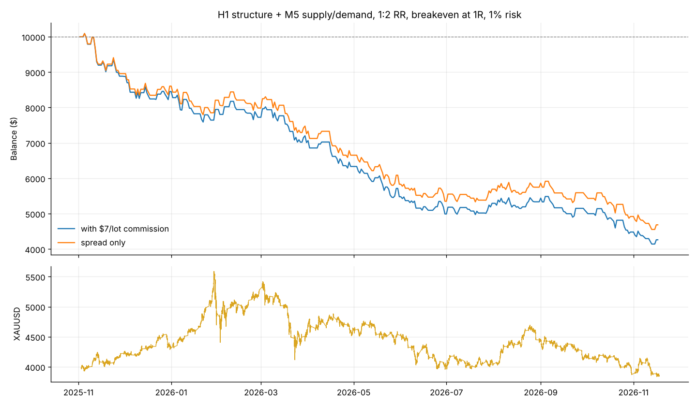

# Supply/demand + market structure strategy: backtest

Data: Dukascopy spot XAUUSD (BID) 1-minute candles, M5 bars 2025-11-02 to 2026-11-17. Spread $0.3/oz. Start balance $10,000, 1% risk per trade.

|                 |   with $7/lot commission |   spread only |
|:----------------|-------------------------:|--------------:|
| total_return_%  |                   -57.38 |        -53.16 |
| max_drawdown_%  |                   -58.95 |        -54.89 |
| sharpe          |                    -2.89 |         -2.55 |
| trades          |                   540    |        540    |
| win_rate_%      |                    23.33 |         23.33 |
| profit_factor   |                     0.73 |          0.76 |
| avg_R           |                    -0.15 |         -0.14 |
| target_exits    |                   126    |        126    |
| breakeven_exits |                    85    |         85    |
| stop_exits      |                   329    |        329    |
| zones_found     |                  2063    |       2063    |
| zones_touched   |                  1777    |       1777    |

Every trade is in `trades.csv`. Fill rules are conservative: stop beats target inside one bar, and take-profit is not checked on the entry bar.